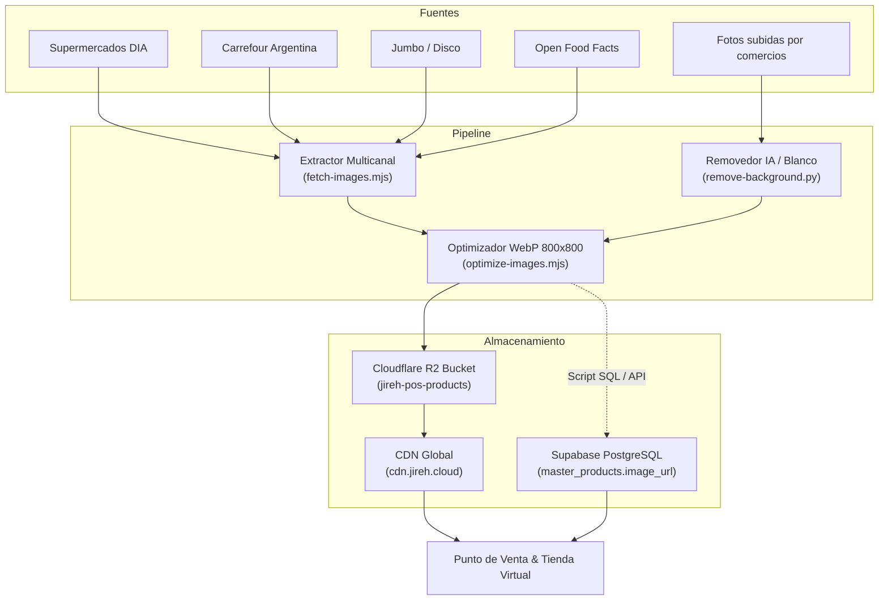

# Guía Paso a Paso: Configuración de Cloudflare R2 para el Catálogo de Productos

Esta guía te explica detalladamente cómo crear y configurar tu almacenamiento en la nube con **Cloudflare R2** para almacenar las fotos oficiales de los productos con fondo blanco, enlazarlas con tu dominio `cdn.jireh.cloud` y servirlas a velocidad extrema con **$0 costo de transferencia (Zero Egress Fees)**.

---

## 📌 ¿Por qué Cloudflare R2?

* **10 GB de almacenamiento gratuito por mes de por vida** (alcanza para más de 150.000 fotos en formato WebP 800x800).
* **0 USD en costo de transferencia de datos:** Nunca pagarás por las descargas de imágenes, sin importar cuántos clientes o tiendas virtuales las vean.
* **Red CDN Global:** Las fotos se entregan desde el nodo perimetral de Cloudflare más cercano a cada comercio en menos de 50 milisegundos.
* **Compatibilidad 100% con el estándar S3:** Se conecta directamente con nuestros scripts automatizados en `tools/catalog-images/`.

---

## Paso 1: Ingresar a Cloudflare y acceder a R2

1. Ingresá a [https://dash.cloudflare.com/](https://dash.cloudflare.com/) con tu cuenta de Cloudflare.
2. En el menú lateral izquierdo, hacé clic en **R2 Object Storage** (o **R2**).
3. Si es tu primera vez usando R2, Cloudflare te pedirá activar el servicio asociando un método de facturación (no te cobrará nada dentro de la cuota gratuita de 10 GB y 10 millones de lecturas mensuales).

---

## Paso 2: Crear el Bucket de Almacenamiento

1. Dentro de la sección **R2**, hacé clic en el botón azul **Create bucket** (*Crear bucket*).
2. Configurá los siguientes campos:
   * **Bucket name:** `jireh-pos-products` (o el nombre que prefieras).
   * **Location:** Dejá seleccionada la opción **Automatic** (*Recomendado*) o South America.
3. Hacé clic en **Create bucket** al final de la página.

---

## Paso 3: Habilitar Acceso Público y Conectar tu Dominio

Para que el Punto de Venta, la app móvil y la futura tienda virtual puedan cargar las fotos públicamente, necesitamos habilitar el acceso de lectura al bucket:

1. Entrá a tu nuevo bucket (`jireh-pos-products`) y hacé clic en la pestaña superior **Settings** (*Configuración*).
2. Hacé scroll hacia abajo hasta la sección **Public Access** (*Acceso público*).
3. Tenés dos opciones:

### Opción A (Recomendada): Conectar tu subdominio `cdn.jireh.cloud`
* En **Custom Domains**, hacé clic en **Connect Domain**.
* Ingresá tu subdominio: `cdn.jireh.cloud` (o `assets.jireh.cloud`).
* Hacé clic en **Continue** y luego en **Connect Domain**.
* Cloudflare gestionará automáticamente el certificado SSL HTTPS gratuito en cuestión de minutos.

### Opción B (Para pruebas inmediatas):
* En **R2.dev subdomain**, hacé clic en **Allow Access**.
* Escribí `allow` para confirmar.
* Cloudflare te dará una URL pública temporal similar a: `https://pub-xxxx.r2.dev`.

---

## Paso 4: Crear las Credenciales de API (Tokens S3)

Para que nuestros scripts del repositorio puedan subir las fotos procesadas al bucket de R2, necesitamos generar un token de acceso:

1. En el menú lateral izquierdo de Cloudflare, volvé a hacer clic en **R2 Object Storage**.
2. En el panel derecho, hacé clic en **Manage R2 API Tokens** (*Administrar tokens de API de R2*).
3. Hacé clic en **Create API token**.
4. Configurá el token con estos parámetros:
   * **Token name:** `jireh-pos-catalog-sync`
   * **Permissions:** Seleccioná **Object Read & Write** (*Lectura y Escritura de Objetos*).
   * **Specify bucket:** Podés elegir `Apply to all buckets` o seleccionar únicamente `jireh-pos-products`.
   * **TTL (Duración):** Dejá seleccionado *Forever* (*Para siempre*).
5. Hacé clic en **Create API Token** al pie de la página.
6. **¡MUY IMPORTANTE!** Cloudflare te mostrará los datos del token **por única vez**. Copiá y guardá en un lugar seguro:
   * **Account ID** (ID de cuenta).
   * **Access Key ID** (ID de clave de acceso).
   * **Secret Access Key** (Clave de acceso secreta).
   * **Jurisdiction-specific endpoint URL** (URL de endpoint S3, que luce como: `https://<ACCOUNT_ID>.r2.cloudflarestorage.com`).

---

## Paso 5: Configurar las Variables en Jireh POS

Abrí tu archivo local `.env` (en la raíz del proyecto `c:\IMPORTANTE-NO-ELIMINAR\POS\.env`) y agregá las siguientes líneas con tus datos reales:

```env
# ==========================================
# CLOUDFLARE R2 & CDN DE CATÁLOGO
# ==========================================
R2_ACCOUNT_ID=tu_account_id_aqui
R2_ACCESS_KEY_ID=tu_access_key_id_aqui
R2_SECRET_ACCESS_KEY=tu_secret_access_key_aqui
R2_BUCKET_NAME=jireh-pos-products
R2_PUBLIC_URL=https://cdn.jireh.cloud
```

*(Si usás Vercel para producción en `app.jireh.cloud`, agregá también estas variables en el panel de Vercel > Settings > Environment Variables).*

---

## Paso 6: Ejecutar el Pipeline Automatizado de Imágenes

Ya dejamos programadas todas las herramientas en la carpeta `tools/catalog-images/`. Para ejecutar el proceso disponés de los siguientes comandos desde tu terminal:

### 1. Prueba de Simulación (Dry-Run sin credenciales):
```bash
node tools/catalog-images/sync-r2.mjs --dry-run
```
* Simula la subida y genera el archivo SQL con las URLs de actualización en `tools/catalog-images/cache/sync_master_products_images.sql`.

### 2. Extracción de Lotes por Cantidad:
```bash
# Extraer fotos oficiales para los primeros 50 productos:
node tools/catalog-images/fetch-images.mjs --limit=50

# Extraer para un producto específico por código de barras:
node tools/catalog-images/fetch-images.mjs --barcode=7790895000997
```

### 3. Optimización a WebP 800x800 con Lienzo Blanco Puro:
```bash
node tools/catalog-images/optimize-images.mjs
```
* Centra el envase, agrega padding respirable de estudio, quita impurezas de fondo y comprime a WebP de 40-60 KB.

### 4. Sincronización Real con Cloudflare R2 y Supabase:
```bash
node tools/catalog-images/sync-r2.mjs
```
* Sube todas las fotos optimizadas a `jireh-pos-products/productos/{barcode}.webp` con cabeceras inmutables de caché por 1 año.
* Genera el script SQL para actualizar `master_products.image_url` en Supabase.

### 5. Pipeline Integral Todo en Uno:
```bash
# Ejecuta Extracción -> Optimización -> Subida en un solo comando:
node tools/catalog-images/pipeline.mjs --limit=100
```

---

## Paso 7: Remoción Automática de Fondo para Fotos de Clientes

Cuando un comerciante saca una foto de un producto no catalogado desde el mostrador de su local:

1. Disponés del script con Inteligencia Artificial `tools/catalog-images/remove-background.py`:
   ```bash
   python tools/catalog-images/remove-background.py --input foto_celular.jpg --output 7791234567890.webp
   ```
2. El script detecta el envase, recorta automáticamente el mostrador/fondo, monta la imagen sobre un lienzo blanco puro `#FFFFFF` de 800x800 píxeles y genera el archivo WebP optimizado listo para enviar a R2.

---

## Arquitectura y Flujo de Datos


